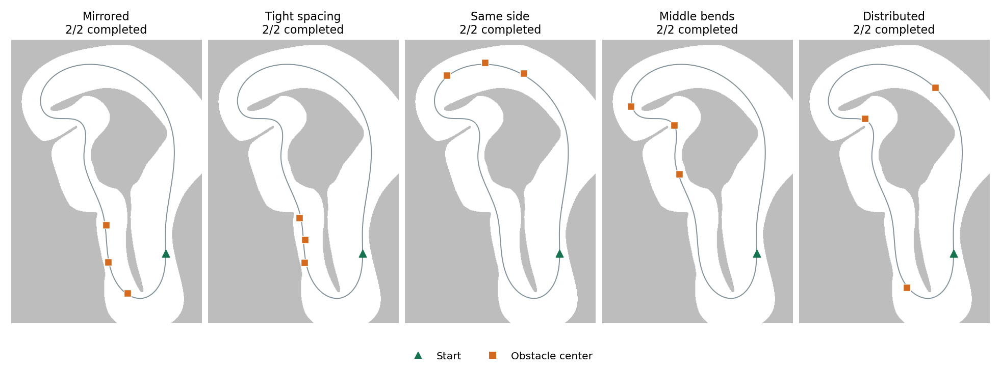

# Berlin 정방향 장애물 배치별 ROS 주행

장애물 배치 5개를 각각 두 번 주행했다. 완주 기준은 결승선 전 정지·충돌 없이 연속 3랩(146.35 m)을 달리는 것이다. 전체 10회 중 10회가 통과했고 충돌을 기록한 실행은 0회였다.

| 배치 | 출발선에서 장애물까지 거리(m) | 진행 방향 기준 횡오프셋(cm, + 왼쪽) | 성공/시도 |
|---|---|---|---:|
| 좌우 반전 | 5.7 · 8.7 · 11.7 | −8.3 / +8.3 / −8.3 | 2/2 |
| 촘촘한 교차 | 8.7 · 10.5 · 12.3 | +12 / −12 / +12 | 2/2 |
| 후반 한쪽 배치 | 26.7 · 29.9 · 33.1 | +12 / +12 / +12 | 2/2 |
| 중반 연속 곡선 | 16.0 · 20.0 · 24.0 | −10 / 0 / +10 | 2/2 |
| 트랙 전역 분산 | 6.5 · 20.7 · 34.9 | +8 / −12 / +4 | 2/2 |



| 실행 및 원본 CSV | 결과 | 완주한 랩 시간(s) | 계획 활성화 거리(m) | 계획에 의한 Avoid 진입 횟수 | 계획 속도 상한 적용 스텝 |
|---|---|---|---:|---:|---:|
| [좌우 반전 1회](trials/mirror-1.csv) | 3랩 완주 | 31.60 / 26.98 / 26.75 | 48.78 | 1 | 943 |
| [좌우 반전 2회](trials/mirror-2.csv) | 3랩 완주 | 30.26 / 25.07 / 27.46 | 48.78 | 1 | 915 |
| [촘촘한 교차 1회](trials/tight-1.csv) | 3랩 완주 | 30.76 / 26.00 / 25.48 | 48.78 | 2 | 816 |
| [촘촘한 교차 2회](trials/tight-2.csv) | 3랩 완주 | 30.21 / 26.32 / 25.98 | 48.78 | 2 | 811 |
| [후반 한쪽 배치 1회](trials/same-side-1.csv) | 3랩 완주 | 30.27 / 25.10 / 23.72 | 48.78 | 2 | 823 |
| [후반 한쪽 배치 2회](trials/same-side-2.csv) | 3랩 완주 | 32.74 / 28.26 / 28.79 | 48.78 | 2 | 1142 |
| [중반 연속 곡선 1회](trials/mid-bends-1.csv) | 3랩 완주 | 33.23 / 28.83 / 28.99 | 48.78 | 2 | 1307 |
| [중반 연속 곡선 2회](trials/mid-bends-2.csv) | 3랩 완주 | 33.11 / 30.94 / 30.64 | 48.78 | 2 | 1352 |
| [트랙 전역 분산 1회](trials/distributed-1.csv) | 3랩 완주 | 30.92 / 32.27 / 32.34 | 48.78 | 6 | 1662 |
| [트랙 전역 분산 2회](trials/distributed-2.csv) | 3랩 완주 | 33.19 / 32.70 / 32.83 | 48.78 | 6 | 1659 |

## 시험 조건과 판정

- 출발 웨이포인트 37, 장애물 3개(각 30 × 30 cm), 첫 랩 2.2 m/s·이후 3.0 m/s 상한, 동일한 WSP Race 및 기존 Avoid 체크포인트와 150 ms 센서 보호 기준을 사용했다. 모든 배치는 주행 시작 전 지정했고 주행 중 위치를 고정했다.
- 각 실행은 별도의 ROS 도메인에서 시뮬레이터·시나리오·제어기를 새로 시작했다. 출발 위치, 빈 계획 카운터, 시나리오가 실제 발행한 장애물 세 개의 위치·방향을 대조했다. 장애물 발행 원문은 각 CSV와 같은 이름의 -poses.yaml이다.
- 첫 랩은 차량의 관측으로 계획을 기록한다. 계획 감속이 적용된 상태에서도 센서 판단이 먼저 Avoid로 전환할 수 있으므로, 계획 전환과 계획 속도 상한의 적용 횟수를 별도로 기록했다. 속도 상한 스텝은 실측 감속 횟수를 뜻하지 않는다.
- 사전 정지·충돌을 실패로 세며, 마지막 결승선의 정지 명령은 제외했다. 정지는 보호 정지 명령, 유효하지 않은 명령, 또는 출발 후 0.5 m 이상 진행한 뒤 속도 0.05 m/s 미만으로 판정했다. 랩타임은 ROS 센서 시각을 사용해 웨이포인트 진행 거리가 랩 길이(허용오차 1 cm)에 도달한 첫 샘플에서 계산했다.
- [배치 설정](trials/layouts.json) · [실행별 판정·전환 위치](results.json) · [주행 스크립트](run.py) · [검증 스크립트](analyze.py)

같은 실험을 다시 실행할 때는 개발 컨테이너의 /workspace에서 아래와 같이 새 출력 디렉터리를 지정한다.

```bash
python3 runs/berlin-layout-sweep/run.py runs/berlin-layout-repeat
python3 runs/berlin-layout-sweep/analyze.py runs/berlin-layout-repeat
```
